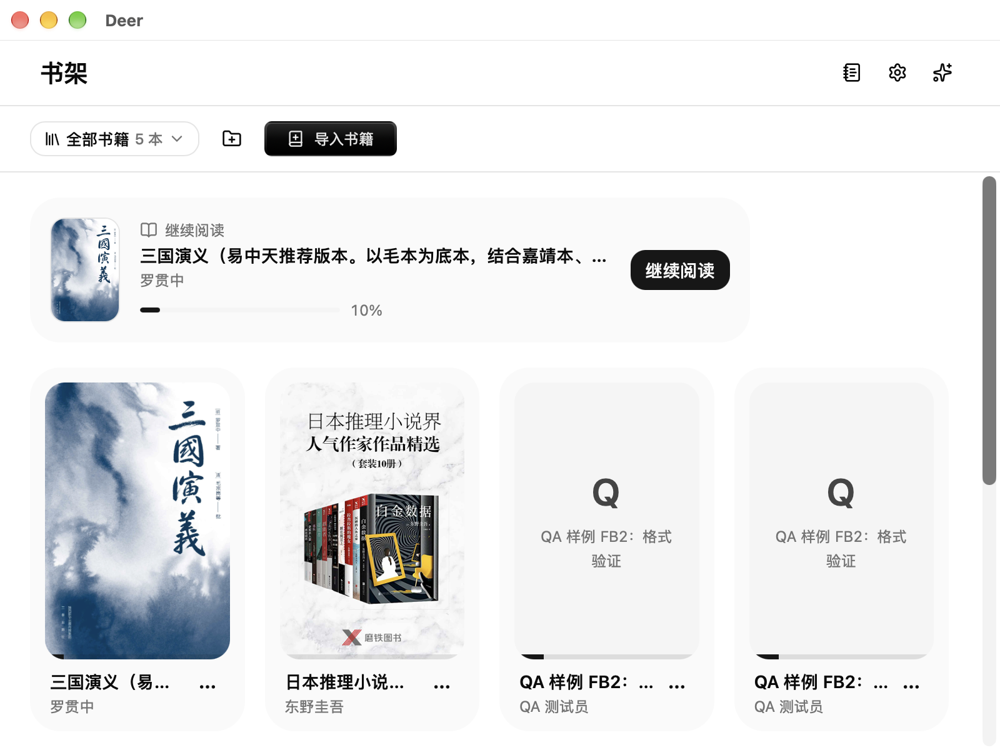

# Deer

> **Read gently. Understand deeply.**

**Deer** is a local-first AI reading companion for the desktop. It keeps your books on your own machine, lets you read them the way you like, and puts an AI companion beside the page when you want to go deeper.

**Languages:** English · [简体中文](README.zh-CN.md)

---

## About

**Deer** is named after a line from the Chinese classic *Lu Ming* (鹿鸣) in the *Book of Songs* — a call of welcome and friendly exchange. It sits beside you as you read: explaining hard passages, mapping ideas, answering questions, and drawing connections.

Deer doesn't read for you. It helps you read better, think further, and enjoy the journey.

## Features

### Library

- Import **EPUB, MOBI, AZW3, FB2, CBZ and PDF**; files are copied into the app's data directory, covers are extracted automatically
- Organize books on **shelves**, with four sort orders (recently read, title, author, date added)
- **Continue reading** card resumes the last book at the exact spot

### Reading

- **Table of contents** as a popover from the toolbar, plus chapter navigation
- **Paginated or scrolled** layout, with page-turn animation in three levels (off / fade / slide)
- Reading preferences: six font sizes, five line heights, three page margins, book or system fonts, paper colors, and a dark theme
- **Highlights and notes**: select text to highlight in several colors and styles, attach a note, and edit or recolor from the same popover
- **Notes page** collecting every highlight and note across the library
- **Footnote peek** for EPUB: hover a footnote marker to read the note in place
- Quick settings panel and full settings dialog (general, appearance, reading, AI, data, shortcuts, about)

### AI companion

- Docked chat panel on both the bookshelf and the reader — open it without sending anything, ask when you're ready
- **Dual AI links with engine routing**: local engines run through acpx — 27 of them (Claude Code, Codex, Kimi, Qwen, Gemini, Cursor and more; official acpx adapters install with one click, vendor CLIs are detected if already installed) — while cloud engines run in the webview over the Vercel AI SDK against your own provider endpoints (OpenAI-compatible / Anthropic). Settings offers three routing modes: **auto** (local when available, falls back to cloud), **local-only** and **cloud-only**
- Chapter summaries, passage explanations, open-ended Q&A, and an idea map that shows how concepts connect
- **Pre-reading briefing**: before diving into a thick book, ask for a whole-book skeleton card — the author's mental model, a chapter map, and the recurring core concepts
- The model can query your shelf through a built-in MCP server (`search_books`, `get_reading_state`, `get_library`) and return book cards you can open directly

### Sync (WebDAV)

- Keep **reading progress, highlights and notes** in step across your devices through your own WebDAV drive (e.g. Jianguoyun) — no middleman server, the credentials stay on your machine
- Optionally upload **book files and covers** too; turn that off to sync metadata only

### Backup & restore

- Export your whole library — book files, covers, highlights & notes, chat history, concept maps, and settings — as a single `.deer-backup` archive (Settings → Backup & restore)
- Restore from an archive with **merge semantics**: books you already have (matched by content hash) are skipped, notes are merged by position, nothing is overwritten
- Everything is local-first: no cloud account, the archive file is yours to copy anywhere

## Requirements

- Node **22.13+** (local AI engines run through acpx on Node; cloud engines need no local runtime)
- pnpm **12.3.4** (`packageManager` is pinned)
- Rust toolchain and the Tauri v2 system prerequisites for the desktop build
- `acpx@0.21.1` for local AI engines: `npm install -g acpx@0.21.1`
- For local engines, at least one engine CLI of your choice (the Settings → AI list shows install status for each); cloud engines only need your own API key and endpoint in Settings

## Screenshots

| | |
|---|---|
|  |  |
| *Bookshelf with continue-reading* | *Reader with footnote links* |


*The AI companion docked beside the page*

## What's new in v0.3.0

Highlights since v0.2.0:

- **Dual-link AI with engine routing** — local engines run through acpx, cloud engines talk to your own provider endpoints, with auto / local-only / cloud-only routing
- **WebDAV sync** — reading progress, highlights & notes follow you across devices via your own WebDAV drive
- **Pre-reading briefing** — a whole-book skeleton card (mental model / chapter map / core concepts) before you start a thick book
- **Backup & restore** — the whole library exports as a single `.deer-backup` archive and restores with merge semantics
- **Security baseline** — production CSP and least-privilege Tauri capabilities
- **Lighter, faster frontend** — route- and feature-level code splitting trims the first-paint bundle

## Installation

Download the latest disk image from [Releases](https://github.com/catnuko/deer/releases) — for this release, [v0.3.0](https://github.com/catnuko/deer/releases/tag/v0.3.0), the asset is named like `Deer_0.3.0_aarch64.dmg`. The `.dmg` is built and uploaded automatically by CI whenever a release is tagged (unsigned, no notarization).

1. Open the `.dmg` and drag **Deer** into `Applications`.
2. First launch: because the build is **unsigned** (no Apple Developer certificate yet), macOS Gatekeeper blocks apps it can't verify. Right-click **Deer.app → Open**, then confirm; or clear the quarantine flag:
   ```bash
   xattr -cr /Applications/Deer.app
   ```

- **Platform:** Apple Silicon (aarch64) only
- **macOS:** 11 (Big Sur) or later
- Books, notes and settings stay on your machine; local AI features additionally need Node 22.13+, acpx and one engine CLI — see [Requirements](#requirements)

## Getting started (build from source)

```bash
pnpm install
pnpm tauri dev     # the real desktop window
```

```bash
pnpm dev           # browser preview of the UI (native APIs unavailable)
pnpm test          # vitest
pnpm lint          # eslint
pnpm build         # type-check + production frontend build
```

Root scripts delegate to `apps/desktop`.

## Project structure

- `apps/desktop` — the Tauri + React application: bookshelf, reader, notes, settings, AI panel
- `apps/desktop/src-tauri` — Rust shell: acpx chat bridge, book MCP server, plugin registration and capabilities
- `apps/desktop/src/vendor/foliate-js` — vendored ebook engine used by the reader
- `docs/` — UX spec, design handoff (motion, tokens) and engineering notes

## Status

Early development. The app UI is currently Simplified Chinese only; macOS is the primary target. Books, annotations and settings are stored locally — nothing is uploaded except the prompts you send to the engine you selected.

## Feedback

Found a bug, or something reads awkwardly? Please [open an issue](https://github.com/catnuko/deer/issues/new) — first-hand feedback from real reading sessions is exactly what shapes Deer's roadmap.

## License

This project is licensed under the **GNU Affero General Public License v3.0 (AGPL-3.0)**. See [LICENSE](LICENSE) for the full text.