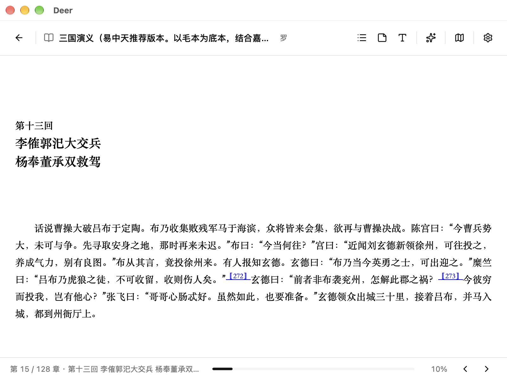

# Deer

> **轻轻读，深深懂。**

**Deer** 是一个本地优先的桌面 AI 阅读伙伴。书放在你自己的机器上，怎么读由你定；想往深处走的时候，AI 就在书页旁边。

**语言：** [English](README.md) · 中文

---

## 关于 Deer

**Deer** 的名字取自《诗经·小雅·鹿鸣》—— 一声欢迎，也是友好的往来。它坐在你身边陪你读：讲清难懂的段落、勾勒思想的地图、回答你的问题，把散落的念头连成线。

Deer 不替你读书；它帮你读得更好、想得更远，也享受这段旅程。

## 功能

### 书架

- 导入 **EPUB、MOBI、AZW3、FB2、CBZ、PDF**；文件复制进应用数据目录，封面自动提取
- 用**书架（shelf）**归置书籍，支持四种排序（最近阅读、书名、作者、添加时间）
- **继续阅读**卡片接着上次那本书、那个位置往下读

### 阅读

- 顶栏弹出**目录**，并支持章节跳转
- **分页 / 滚动**两种版式，翻页动效三档（关闭 / 淡入 / 滑动）
- 阅读偏好：六档字号、五档行距、三档页边距、跟随书籍或系统字体、纸色、深色主题
- **划线高亮与笔记**：划选文字即可上色、换样式、写批注，同一浮层里改色或编辑
- **笔记页**汇总全库的划线与笔记
- EPUB **脚注悬浮预览**：鼠标停在脚注标号上就地出卡
- 阅读页快捷设置，以及完整设置弹窗（通用 / 外观 / 阅读 / AI 伴读 / 数据 / 快捷键 / 关于）

### AI 伴读

- 书架与阅读页都有**停靠式聊天面板**：点开是空面板，想问了再发
- 经 acpx 接入**27 个引擎**：Claude Code、Codex、Kimi、Qwen、Gemini、Cursor 等，在设置里选用；acpx 官方适配器一键安装，厂商 CLI 若已安装会自动识别
- 章节总结、段落解读、开放式问答，以及展示概念关联的**概念地图**
- 模型可通过内置 MCP 服务查询你的书架（`search_books`、`get_reading_state`、`get_library`），返回的书单以书卡形式呈现，点击直接打开

## 环境要求

- Node **22.13+**（AI 面板经 acpx 跑在 Node 上）
- pnpm **12.3.4**（`packageManager` 已锁定）
- Rust 工具链，以及 Tauri v2 所需的系统依赖
- AI 功能需要 `acpx@0.21.1`：`npm install -g acpx@0.21.1`
- 至少安装一个你想用的引擎 CLI（设置 → AI 伴读 会逐行显示安装状态）

## 截图

| | |
|---|---|
|  |  |
| *书架与继续阅读* | *阅读页与脚注链接* |


*停靠在书页旁边的 AI 伴读面板*

## 安装

从 [Releases](https://github.com/catnuko/deer/releases) 下载最新的镜像文件，资产名形如 `Deer_0.2.0_aarch64.dmg`：

1. 打开 `.dmg`，把 **Deer** 拖进「应用程序」。
2. 首次启动：构建目前**未签名**（还没有 Apple 开发者证书），macOS Gatekeeper 会拦下无法验证的应用。右键 **Deer.app → 打开**并确认；或直接清除隔离标记：
   ```bash
   xattr -cr /Applications/Deer.app
   ```

- **平台：** 仅 Apple Silicon（aarch64）
- **系统：** macOS 11（Big Sur）及以上
- 书籍、笔记和设置都保存在本机；AI 功能另外需要 Node 22.13+、acpx 和一个引擎 CLI，见[环境要求](#环境要求)

## 快速开始（从源码构建）

```bash
pnpm install
pnpm tauri dev     # 真正的桌面窗口
```

```bash
pnpm dev           # 浏览器里预览界面（没有原生能力）
pnpm test          # vitest
pnpm lint          # eslint
pnpm build         # 类型检查 + 生产构建
```

根目录脚本会转调到 `apps/desktop`。

## 目录结构

- `apps/desktop` —— Tauri + React 应用：书架、阅读、笔记、设置、AI 面板
- `apps/desktop/src-tauri` —— Rust 外壳：acpx 聊天桥、书架 MCP 服务、插件注册与能力权限
- `apps/desktop/src/vendor/foliate-js` —— 阅读器内置的电子书引擎
- `docs/` —— UX 规范、设计交接（动效、token）与工程笔记

## 状态

早期开发中。界面目前只有简体中文，主要面向 macOS。书籍、批注和设置都保存在本地——除了你发给所选引擎的提问，不上传任何内容。

## 许可证

本项目采用 **GNU Affero 通用公共许可证第 3 版（AGPL-3.0）** 授权，完整条款见 [LICENSE](LICENSE)。