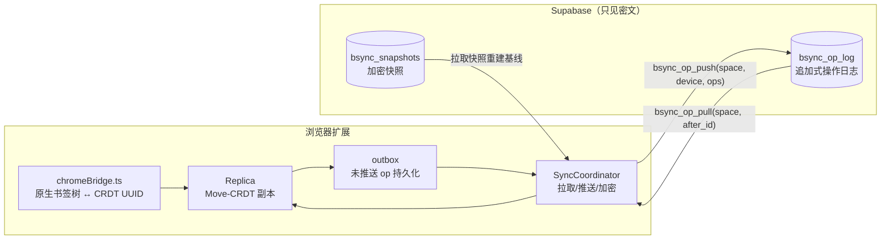
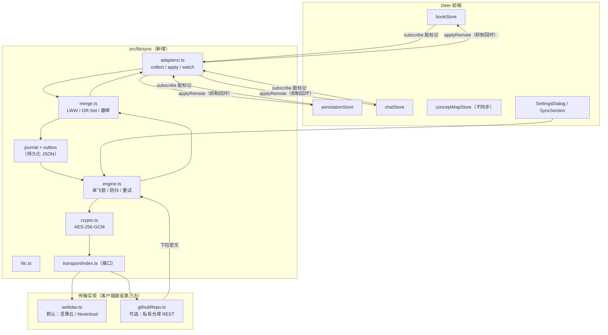

# Deer 同步功能解决方案（设计稿）

> 目标：在不破坏 Deer「本地优先」定位的前提下，为书库、阅读进度、高亮笔记、聊天会话增加多设备同步。
> 参考对象：本工作区内的 bookmark-sync（跨浏览器书签同步，E2EE + Move-CRDT + Supabase），以及「用 WebDAV / GitHub 私有仓库这类客户端直连的第三方存储当同步后端」这一零服务端形态。同业调研见 §2.5。

---

## 0. 一句话结论

**采用「端到端加密 + 追加式操作日志 + 按记录 LWW/墓碑合并 + 本地发件箱」的本地优先同步内核；传输层做成可插拔接口，只对接客户端直连的第三方服务——v1 定为 WebDAV（坚果云 / Nextcloud / 自建 NAS，同业事实标准、国内可用）。**书籍文件与阅读元数据（进度、高亮笔记、书架、会话）都经 WebDAV 同步：元数据走加密操作日志，书文件按内容哈希命名、缺书按需下载（参考 Readest/Koodo 的做法），不做自有后端。

不照搬 bookmark-sync 的 Move-CRDT：Deer 的数据不是「可移动树」，没有节点换父、排序键、并发成环这些难点，照搬会引入数倍复杂度却换不来收益。要复用它的**思想与工程教训**：稳定 ID、墓碑删除、HLC 全序、操作级 E2EE、发件箱持久化、冷启动重放、快照压缩、首同步四象限。

> **v1 落地修订（2026-11，已与产品确认）**
>
> 1. **不做加密**：同步记录与 WebDAV 块均为明文 JSON，凭据只存本机设置。原 §3.4 的 E2EE 设计保留为未来可选层，不属于 v1 交付；隐私边界改为「用户私有 WebDAV 目录」。
> 2. **合并改为记录级 LWW**：v1 不为每个字段记 HLC，同一实体整条记录取 HLC 大者；字段级 LWW 留到 P2。
> 3. **P1 已实现**：同步内核（HLC / 收集 / 发件箱 / 引擎 / 内存与 WebDAV 传输）、书籍内容哈希与旧库补算、三个 store 的远端应用入口、书文件与封面上传、设置页「同步」分组。云端书籍行的按需下载已留内核入口，UI 在 P2。

---

## 1. 背景与目标

### 1.1 目标

1. 两台及以上 Mac（未来含移动端）之间同步：书库元数据、阅读进度、高亮/笔记、书架、聊天记录。
2. 离线可用：断网时正常读写，恢复后自动补传。
3. 隐私默认：数据只进用户自己的私有 WebDAV 目录（v1 明文，设置页明确提示目录必须私有）。
4. 不丢数据：任何并发修改都收敛到确定结果，删除可传播且不会被离线设备「复活」。
5. 可交付：分阶段落地，每阶段可独立验收。

### 1.2 非目标（v1 明确不做）

- 不做账号体系与托管计费；第三方存储的凭据即身份（WebDAV 应用密码 / GitHub PAT）。
- 不做笔记/书库的实时协同编辑——同步目标是「多设备一致」，不是「多人协作」。
- 不同步概念地图缓存（可再生、体积大）、AI 引擎/API Key 等设备本地配置。
- 不做自建服务端：全部走客户端直连的第三方存储（v1 定为 WebDAV）。

---

## 2. 现有方案调研

### 2.1 「现有的 GitHub 方案」的两种可能解读

| 解读 | 对应事实 | 本稿处理 |
|---|---|---|
| A. 参考 GitHub 上的开源项目 bookmark-sync 的同步设计 | bookmark-sync 就在本工作区，是 AGPL 开源项目 | §2.2 完整拆解，作为算法与工程蓝本 |
| B. 用 GitHub 仓库/Gist 充当同步存储 | Deer 已有 `docs/auto-update-plan.md`，把 GitHub Releases 作为更新清单托管，说明项目倾向「零新增基建」 | §4 给出 GitHub 传输层设计（可选 provider）；默认 provider 在调研后改为 WebDAV（§2.5） |

两种解读并不冲突：架构内核来自 A，传输层按 B 落地。

> **先澄清一个事实**：我完整检索了 bookmark-sync 的全部历史，**它从来没有把 GitHub 当同步存储**——后端始终是 Supabase（Postgres + Auth + RLS + RPC）；`api.github.com` 只用于两处：反馈转 Issue 的触发器（`supabase/migrations/0054_github_issue_sync.sql`）和 README 里的反馈入口。GitHub 在这个项目里是「托管仓库 + CI + 反馈」，不是同步通道。所以「参考现有的 GitHub 方案」若指 A，参考的是它的同步架构；若指 B，则 §4 是全新设计。

### 2.2 bookmark-sync 的同步架构拆解

**技术栈**：Chrome/Edge/Firefox Manifest V3 扩展，Vue 3 + TypeScript；后端 Supabase（Postgres + Auth，邮箱密码）；同步跑在后台 Service Worker。

**分层（`src/sync/syncEngine.ts:1-40`、`src/sync/oplogClient.ts:1-20`）**：



**核心机制清单**（可直接借鉴的部分）：

1. **操作日志是唯一事实源，物化树可重建**。`bsync_op_log` 追加写入，全局 `bigserial id` 作为增量游标；客户端按 `after_id` 拉取，任何顺序应用都收敛。
2. **每设备单调序号 + 服务端幂等**。`seq` 取该设备 Lamport 计数，`ON CONFLICT(space_id, device_id, seq) DO NOTHING`；重复推送天然安全（`oplogClient.ts:1-20`）。
3. **操作级 E2EE**。整个 op（含父节点、元数据、时间戳）用 AES-256-GCM 加密成 `{iv, ciphertext}` 信封再入 JSONB；AAD 绑定 `space_id`，密文不能跨租户搬运（`src/sync/opCrypto.ts:1-40`）。
4. **密钥来自用户口令**，每用户随机 salt（PBKDF2-HMAC-SHA256，210,000 次，`src/crdt/crypto/key.ts:93-112`），密钥只存本机，新设备靠同一口令恢复（`src/sync/keyManager.ts:1-45`）。**无密钥即拒绝同步，不自动生成随机密钥**——否则新设备永远解不开历史密文。
5. **口令校验与首设备三态判定**：不存密码哈希，而是用候选密钥去解「账号下最新一条真实 op」，解得开才算口令正确（`src/store.ts:389-418`）；首设备判定返回 `true/false/null`，网络失败时按「非首设备」保守处理，避免第二台设备误设新口令覆盖盐（`src/crypto.ts:124-129`）。这两点是安全设计精华，值得原样借鉴。
6. **全序时间戳** 给每个操作定序，并发冲突按 LWW 定序。注意：bookmark-sync 文档里称「HLC」，但代码里其实是 Lamport 时间戳 `{counter, replicaId}`，平局用 replicaId 字典序决胜（`src/crdt/timestamp.ts:1-20`）——没有物理时钟成分，所以无法回答「这条笔记是什么时候改的」。Deer 需要展示更新时间、且进度类数据按真实时间取新，故本稿改用**真 HLC `{wall, counter, node}`**。
7. **墓碑删除**：删除 = 把节点移到 TRASH，不物理移除，防止离线设备把已删数据带回（`src/crdt/moveCrdt.ts`）。
8. **发件箱（outbox）持久化**：本地 op 先落盘再推送，推送成功按 seq 删除；进程被回收也不会丢操作，重复推送由服务端幂等兜底（`src/crdt/storage/outbox.ts:1-30`）。
9. **冷启动重放保护**：空副本 + 非零水位时先从快照/全量重建，再执行删除投影；解密失败时**跳过删除**，避免「同步成功、本机数据却少了」（`src/sync.ts:900-935`）。
10. **快照 + GC 水位**：op 日志超阈值时生成加密快照，客户端以 watermark 跳过已折叠的历史（`src/crdt/replica.ts:47-60`）。
11. **首同步四象限**：新设备首次同步按「本地有无数据 × 远端有无数据」决定自动拉取 / 自动推送 / 弹窗三选一（合并、远程覆盖本地、暂不同步），判定粒度是 **(设备 × 空间)**。注意 `docs/design/first-sync-ux.md` 记录的是 2026-09 的历史形态，后来被「设备绑定空间」门禁取代；四象限判定思想仍适用，具体交互以当前代码为准。
12. **配额与限流是产品的一部分**：免费档按条数限额，超额时仍放行删除类 op，否则用户删了也同步不上去（`syncEngine.ts:56-70`）。

**不可照搬的部分**：

- Move-CRDT、分数排序键（LexoRank/LSEQ）、并发成环检测、原生书签 ID ↔ UUID 双向映射：都是「树形书签 + 浏览器 API」特有复杂度。
- 浏览器 MV3 生命周期问题（Service Worker 30 秒回收、多标签页协调）：Deer 是常驻桌面进程，无此约束，但有等价的「进程被杀」场景，用 outbox 解决。

### 2.3 Deer 现状

**技术栈**：Tauri 2（Rust 薄壳）+ React 19 + Vite + TypeScript + Zustand 5；无后端、无账户体系；唯一外网调用是 AI 云引擎（`ai` SDK，OpenAI 兼容 / Anthropic 协议，Key 存 localStorage）。

**数据面（四个 JSON 文件 + 书籍二进制）**：

| 数据 | 文件 / 位置 | 结构 | 写入方式 |
|---|---|---|---|
| 书库与书架 | `appDataDir/library.json` | `books: Book[]`、`shelves: Shelf[]`（`src/lib/types.ts:4-20`） | `bookStore.persist()` 手动 save |
| 高亮与笔记 | `annotations.json` | `Record<bookId, StoredAnnotation[]>`（`annotationStore.ts:9-23`） | 同上 |
| 聊天 | `chat.json` | `threads: Record<bookId, ChatThread[]>`、`messages: Record<threadId, ChatMessage[]>`、`feedback`、`acpxSessionByThread` | 同上 |
| 概念地图 | `conceptmaps.json` | `Record<"bookId::chapterKey", CachedConceptMap>` | 同上 |
| 设置 | localStorage（zustand persist） | `AppSettings`、`ReadingSettings`，带 `version` + `migrate` | 自动 |
| 书籍文件 | `appDataDir/books/<id>.<fmt>`、`covers/` | 二进制 | 导入时复制 |

**关键代码入口**：

- 书库：`apps/desktop/src/store/bookStore.ts`（导入 `:146-218`、持久化 `:61-66`、`updateBook` `:238-245`）
- 笔记：`apps/desktop/src/store/annotationStore.ts`
- 聊天：`apps/desktop/src/store/chatStore.ts`
- 阅读进度写回：`apps/desktop/src/routes/reader/ReaderPage.tsx:818-830`（节流后 `updateBook(id, {progress, lastLocationCfi})`）
- 设置：`apps/desktop/src/store/appSettings.ts:84-163`（version 5 迁移模式）、`src/components/settings/SettingsDialog.tsx:29-38`（分组导航）
- 数据管理 UI：`src/components/settings/DataSection.tsx`（仅打开目录、统计、清空）

**现状里最要命的三点**：

1. **书籍 ID 是本机随机 UUID**（`bookStore.ts:179`，`crypto.randomUUID()`），`filePath` 也是本机路径。换设备后同一本书 ID 不同 → 笔记、进度、会话无法归位。**同步前必须引入内容哈希作为跨设备身份。**
2. **所有记录都没有 `updatedAt` / 删除墓碑**。合并时无法判断谁更新，删除也会被其它设备「复活」。
3. **没有统一持久化抽象**。四个 store 各自实现读写；同步需要一层适配器，否则每个 store 都要改一遍逻辑。

### 2.4 差距分析

| 能力 | bookmark-sync | Deer 现状 | 落地动作 |
|---|---|---|---|
| 稳定身份 | GUID + 原生 ID 映射 | 随机 UUID，书籍无内容哈希 | 引入 `contentHash`（SHA-256），本地 `id` 保留为设备内主键 |
| 变更追踪 | 事件桥接 + 重扫描 | 无 | store `subscribe` + 每模块 `collectRecords()` + 脏标记 |
| 时间戳/冲突 | HLC + Move-CRDT | 无 | HLC + 按字段 LWW / OR-Set |
| 删除传播 | 墓碑 | 直接数组删除 | 墓碑记录，保留 90 天 |
| 加密 | op 级 AES-256-GCM | 无 | 同一套信封格式 |
| 传输 | Supabase RPC | 无 | `Transport` 接口 + WebDAV（默认）/ GitHub（可选） |
| 发件箱 | IndexedDB outbox | 无 | `sync-state.json` 内的 outbox |
| 首同步 UX | 四象限弹窗 | 无 | 同类弹窗，按数据条数展示 |

### 2.5 同业调研：GitHub 上的阅读软件靠什么同步

| 项目 | 同步内容 | 通道 | 备注（star 数量级） |
|---|---|---|---|
| [KOReader](https://github.com/koreader/koreader) | 仅阅读进度 | kosync 自建 HTTP 服务（官方 `sync.koreader.rocks` 或自托管 [`koreader-sync-server`](https://github.com/koreader/koreader-sync-server)） | 协议简单、LWW；约 31k |
| [Readest](https://github.com/readest/readest) | 进度、笔记、书签、书库元数据、可选书文件 | ① 兼容 kosync；② 自建/官方 Supabase 的加密 replica；③ **第三方文件同步：WebDAV / Google Drive / OneDrive / iCloud / S3** | 三条路径并存；约 26k，AGPL |
| [Anx Reader](https://github.com/Anxcye/anx-reader) | 书文件、笔记、进度 | **仅 WebDAV** | 9.2k，MIT |
| [Koodo Reader](https://github.com/koodo-reader/koodo-reader) | 书、封面、笔记、书签、书架 | WebDAV / Dropbox / Google Drive / OneDrive / iCloud / S3 / SFTP 等 | 客户端直连；28.8k |
| [阅读 Legado](https://github.com/gedoor/legado) | 书架、笔记、书源、阅读记录、配置 | **WebDAV**（每日整包备份 + 每本书进度 JSON） | 47.2k，中文社区 |
| Moon+ Reader（闭源） | 位置、书签、高亮、笔记、书文件 | WebDAV / Dropbox（Pro） | 私有格式 |
| [Foliate](https://github.com/johnfactotum/foliate) | 无内置同步 | 无（靠 Syncthing/Dropbox 自行同步） | 8.9k |
| [Thorium Reader](https://github.com/edrlab/thorium-reader) | 无实时同步 | 标注 JSON 导入/导出 | 2.9k |
| [Booklore](https://github.com/booklore-app/booklore) / BookOrbit | 书库、进度、标注 | 自建服务端，对外提供 kosync / Kobo 同步 / OPDS | 需部署 Docker |

四个结论：

1. **「没有自有服务端」场景的事实标准是 WebDAV**：Anx 只支持它，Koodo/Legado/Moon+/Readest 都支持它，坚果云在国内可直接用。其次是云盘 OAuth（Drive/OneDrive/iCloud）与 S3 兼容存储。
2. **进度同步有事实标准 kosync**：`PUT /syncs/progress`，字段 `document`（文件名 MD5 或「12 个固定偏移各读 1KiB 的部分 MD5」）、`progress`、`percentage`、`device`、`device_id`，鉴权为 `X-Auth-User` + 密码 MD5；冲突策略是**服务端盖章的 LWW**，客户端约 25s 防抖。Readest、Booklore、Calibre-Web 系都做了兼容。
3. **用 GitHub 仓库/Gist 当阅读器同步存储，没有主流先例**。git 适合文本笔记（Obsidian/Logseq 有成熟方案），但书库含二进制、GitHub 有 100MB 单文件限制、缺少小粒度原子写、还有 API 限流——只适合放元数据/进度 JSON。
4. 书文件本身，多数阅读器仍靠 WebDAV/云盘整包同步；只有 Readest/Koodo 这类把「书文件 + 元数据」都纳入 provider。

对 Deer 的直接含义：**默认做 WebDAV，而不是 GitHub**；GitHub 保留为「极客可选 provider」；进度可以额外提供 kosync 兼容模式（P3），让用户在 KOReader/Readest 之间也能续读。

---

## 3. 总体设计

### 3.1 设计原则

1. **本地 JSON 仍是主存储**，同步是叠加层；关闭同步后 Deer 行为完全不变。
2. **同步只搬运「记录级变更」**，不搬整文件；远端只有记录级数据（v1 明文存于用户私有网盘）。
3. **合并必须纯函数、可测试**：`merge(local, remote) -> merged` 不碰 IO。
4. **失败安全优先**：拉取/解析失败不动本地数据；推送失败留发件箱。
5. **设备本地字段绝不入同步**：`filePath`、`acpxSessionByThread`、`feedback`、`activeThreadByBook`、AI Key、界面偏好。

### 3.2 架构



### 3.3 同步记录模型

统一信封，一条记录 = 一个实体的一次变更：

```ts
type Hlc = { wall: number; counter: number; node: string };  // node = deviceId

type SyncRecord =
  | { kind: "book";        key: string; hlc: Hlc; deleted?: true; data?: BookSync }
  | { kind: "shelf";       key: string; hlc: Hlc; deleted?: true; data?: ShelfSync }
  | { kind: "bookShelf";   key: string; hlc: Hlc; deleted?: true }  // OR-Set 成员
  | { kind: "annotation";  key: string; hlc: Hlc; deleted?: true; data?: AnnotationSync }
  | { kind: "chatThread";  key: string; hlc: Hlc; deleted?: true; data?: ThreadSync }
  | { kind: "chatMessage"; key: string; hlc: Hlc; deleted?: true; data?: MessageSync };
```

**实体键设计（跨设备稳定）**：

- `book`: `bk:<contentHash>`。`BookSync` = `{ contentHash, title, author, format, sizeBytes, tags, shelfIds? , progress, lastLocationCfi, lastOpenedAt, addedAt }`；**不含 `id`、`filePath`、`coverPath`**（封面文件走 `covers/<contentHash>.jpg`，见 §4.1；书文件本体走 `books/<contentHash>.<ext>`）。
- `shelf`: `sh:<uuid>`（书架无跨设备冲突场景，UUID 即可）。
- `annotation`: `an:<annotationId>`（现有 `id` 已是 UUID）；`AnnotationSync` 用 `bookHash` 取代 `bookId`，`cfi` 原样保留。
- `chatThread`: `th:<threadId>`，`bookHash` 取代 `bookId`。
- `chatMessage`: `ms:<messageId>`。
- 本地适配层维护 `bookId ↔ contentHash` 双向表；远端记录落库时若本机无该书，书架显示「云端书籍」行（点开即从 WebDAV 下载本体，§4.1）；若用户关闭了书籍文件同步，则保持「待归位」区，导入同文件后自动挂接。
- 顺带修复现有问题：现在删书只删记录、笔记仍留在 `annotations.json` 且因新导入生成新 `bookId` 而永久失联；按 `contentHash` 归位后，重新导入同一文件即可接回笔记与会话。

**每类数据的合并策略**：

| 数据 | 创建 | 修改 | 删除 | 说明 |
|---|---|---|---|---|
| Book 元数据 | 按 key 幂等 | 按**字段** LWW（取 HLC 大者） | 墓碑 | 两台设备分别改标题/标签，两边都保留 |
| 进度 / 位置 | — | 字段 LWW | 随书墓碑 | 阅读中节流写回；远端更新只在「当前书未打开」或本地 HLC 更旧时应用，避免打断阅读 |
| Shelf | 幂等 | LWW | 墓碑 | |
| Book↔Shelf 成员 | OR-Set（add/remove 各带 HLC） | — | remove 墓碑 | 避免「A 加书架、B 同时移出」丢修改 |
| Annotation | 幂等（id 唯一） | 字段 LWW（color/style/note/excerpt） | 墓碑 | 跨设备不会产生重复高亮 |
| ChatThread | 幂等 | title/updatedAt LWW | 墓碑 | 消息随之软删 |
| ChatMessage | 幂等 | 正文 LWW（仅「最终态」入同步） | 墓碑 | **流式增量不同步**：消息生成完成后再入队，避免每字一 op |
| ConceptMap | 不同步 | — | — | 可再生成缓存 |

若 P3 开启 kosync 兼容（§2.5）：只把「进度」这一条映射成 kosync 的 `document`（文件名 MD5 或 12 个固定偏移的部分 MD5）+ `progress`（CFI）+ `percentage`，走 LWW；笔记仍走 Deer 自有格式。这样 Deer 与 KOReader/Readest 之间能共享「读到哪」，但互不污染笔记数据。

### 3.4 加密与密钥（v1 取消，保留为未来选项）

**产品决定：v1 不做加密。** 记录与块以明文 JSON 写入用户自己的 WebDAV 私有目录，换取实现简单、
可直接在网盘里查看与排障、没有口令丢失风险。隐私边界 = 网盘目录权限；设置页明确提示「请确保该目录私有」。

E2EE 仍是可叠加层：`SyncRecord` 是统一信封，只要在 `transport.putChunk/getChunk` 出入口包一层
AES-256-GCM 加解密，合并与引擎完全不用改。原设计要素（口令派生密钥、系统钥匙串保管、口令校验、
首设备三态、恢复密钥导出）留作 P3 的可选能力。

### 3.5 传输层接口

```ts
interface SyncTransport {
  getManifest(): Promise<Manifest | null>;                 // 空间元信息（salt、快照指针）
  listChunks(since: Cursor): Promise<ChunkMeta[]>;          // 其它设备的新增块
  getChunk(meta: ChunkMeta): Promise<EncryptedRecord[]>;    // 拉取并解密由上层做
  putChunk(chunk: EncryptedChunk): Promise<Cursor>;         // 只写自己设备目录，天然无冲突
  putManifest(m: Manifest): Promise<void>;                  // 单指针文件，带 etag 重试
}
```

`Cursor = { [deviceId]: lastSeqApplied }`，存本机 `sync-state.json`。

---

## 4. 传输层实现

传输层只有一个接口（§3.5），具体 provider 可换。**默认实现是 WebDAV（§4.1）**——同业调研（§2.5）显示它是「没有自有服务端」场景的事实标准，国内可直接用坚果云；**GitHub 私有仓库是可选实现（§4.2–§4.6）**，适合已有 GitHub 账号、想要提交历史的用户。

### 4.1 WebDAV（默认实现）

目录布局（`deer-sync/` 为用户在网盘上指定的根目录）：

```
deer-sync/
  meta.json                                  # 明文极小元数据：{schema, spaceId, salt, latestSnapshot?}
  ops/<deviceId>/<startSeq>-<endSeq>.json # 元数据/笔记/进度的加密操作日志块（每设备只写自己的目录）
  snapshots/<hlc>.json                    # 元数据全量快照（可选，P2）
  books/<contentHash>.<ext>                   # 书籍文件本体（不加密，见下）
  covers/<contentHash>.<ext>                 # 封面（小文件，随元数据一起同步）
```

元数据同步的 WebDAV 方法映射：

| 用途 | 方法 |
|---|---|
| 列目录/取元信息 | `PROPFIND Depth: infinity`（或按层 `Depth: 1`） |
| 读块 / 读 `meta.json` | `GET` |
| 写块 / 写 `meta.json` | `PUT`（`meta.json` 带 `If-Match: <etag>` 乐观锁） |
| 建目录 | `MKCOL` |

**书籍文件同步（与元数据同走 WebDAV）**：

- 命名 = `books/<contentHash>.<ext>`，内容寻址天然幂等：同一本书两台设备上传是同一个文件，`PUT` 重试无冲突；上传前先 `PROPFIND` 该文件，已存在就跳过。
- **按需下载**：元数据同步后，本机没有对应文件的书在书架显示为「云端书籍」（封面来自 `covers/`，很小，随元数据一起拉）；点击阅读时才下载本体，下载完成落 `appDataDir/books/` 并接回进度/笔记（`contentHash` 已在元数据里）。
- **明文存储（v1 决定）**：书籍文件、封面与元数据/笔记/进度一样，都以明文存放在用户自己的网盘里。好处是网盘预览、秒传、分享都能用，也省掉大文件加解密开销；代价是目录必须私有。加密（分块 AES-GCM）作为 P3 可选开关保留设计。
- **删除语义**（借 Readest 的经验）：在一台设备删书 → 元数据墓碑传播，其它设备书架移除该行；**云端文件不自动删**，只有用户在任意设备显式点「同时删除云端文件」才发 `DELETE`。避免网盘被误清空。
- 上传/下载都走 Rust command（流式读写 + 进度事件回传 UI），失败可重试；大文件（>50MB）显示进度条，不阻塞阅读。

要点：

- **必须走 Rust HTTP 客户端**（`reqwest` / `tauri-plugin-http`）：webview 的 `fetch` 发不了 `PROPFIND`，且多数 WebDAV 服务不返回 CORS 头。
- 认证：坚果云用「应用密码」走 Basic Auth；Nextcloud/自建 NAS 可用 Basic 或 Token。凭据存系统钥匙串（同 §3.4）。
- 一致性与 GitHub 版相同：每设备只写自己的 `ops/<deviceId>/` 目录；`meta.json` 用 ETag 冲突重试。
- 差异：WebDAV 没有提交历史，误覆盖不可回溯 → 本地保留一份最近同步快照，且 `meta.json` 采用「先写新文件再改指针」的两步法。
- 为什么默认是它：Anx Reader（仅 WebDAV）、Koodo Reader、阅读 Legado、Moon+ Reader 全部支持 WebDAV；坚果云在国内可用，不需要用户有 GitHub 或海外网络。

### 4.2 GitHub：仓库布局

用户建一个**私有仓库**（如 `deer-sync`），结构：

```
meta.json                        # 明文极小元数据：{schema, spaceId, salt, latestSnapshot?}
ops/<deviceId>/<startSeq>-<endSeq>.json   # 该设备自己的追加块，每块 ≤ 200 条 / ≤ 256KB
snapshots/<hlc>.json         # 全量快照（可选，P2）
```

要点：**每台设备只写自己的目录**，Git 层面永远不会冲突；设备间通过「读别人的块」收敛，等价于 bookmark-sync 的 per-device op 流。

**用到的 GitHub REST 端点**（全部走 fine-grained PAT）：

| 用途 | 方法与路径 |
|---|---|
| 读仓库结构 | `GET /repos/{owner}/{repo}/git/trees/{ref}?recursive=1` |
| 读单文件（含内容） | `GET /repos/{owner}/{repo}/contents/{path}?ref={ref}` |
| 新建块文件 | `PUT /repos/{owner}/{repo}/contents/{path}`（body: message/content/base64） |
| 更新 `meta.json` | `PUT /repos/{owner}/{repo}/contents/meta.json`（带 `sha`，409/422 时重读重试） |
| 校验 PAT | `GET /user`（设置页「测试连接」） |

### 4.3 GitHub：一次同步的流程

```
pull:
  1. GET /repos/{owner}/{repo}/git/trees/{branch}?recursive=1   （1 次请求拿到全部块清单）
  2. 对比本地 cursor，筛出各设备未应用的块
  3. GET /repos/.../contents/<path>?ref=... （或 raw_url）逐块下载
  4. 解密 → 逐条按 merge 规则并入 → applyRemote 到 store → 更新 cursor
push:
  5. 发件箱按 ≤200 条切块 → 加密 → PUT /contents/ops/<deviceId>/<range>.json
     （新文件，无 sha 冲突；若已存在则说明重复推送，直接跳过）
  6. 清空已确认的 outbox 行
```

- 认证：`Authorization: Bearer <fine-grained PAT>`，权限只需目标仓库 `Contents: Read and write`。P3 再加 GitHub OAuth Device Flow（免手填 token）。
- 网络：走 `tauri-plugin-http`（Rust reqwest）而非 webview `fetch`，规避 CORS 与 `tauri://localhost` Origin 问题；capability 只放行 `https://api.github.com/*`。
- 限流：认证后 5000 请求/小时。一次同步 ≈ 1 + 新增块数（通常 0–2），每 30–60 秒一轮也远低于限额；遇 403/429 读 `x-ratelimit-reset` 退避。
- 单文件 1MB 限制（Contents API）：块上限 256KB，留足余量。
- **进阶写法（P2 再换）**：用 Git Data API 把「一批块」合成一个 commit（`POST /git/blobs` → `trees` → `commits` → `PATCH /git/refs/heads/main`），请求数从「每块一次」降到「每批 4 次」；游标可改用 **commit SHA**。非快进的 ref 更新会返回 422，正好当乐观锁，重试即可。P1 用 Contents API 足够，数据量小、实现简单。
- Gist 不适合：单文件 1MB、最多 300 文件、没有目录与提交树语义。
- GitHub 没有服务端 GC / RLS / 配额：快照裁剪与旧块清理必须由客户端自己做；安全边界完全靠「私有仓库 + E2EE」。

### 4.4 GitHub：首次同步（四象限）

沿用 bookmark-sync 的判定，但粒度简化为「(设备 × 空间)」：

| 本地 | 远端 | 行为 |
|---|---|---|
| 空 | 有数据 | 自动拉取（无感） |
| 有数据 | 空 | 自动推送（无感） |
| 空 | 空 | 只登记设备 |
| 有数据 | 有数据 | 弹窗：**合并（推荐）/ 用云端覆盖本机 / 用本机覆盖云端 / 暂不同步** |

判定信号：本机 `sync-state.json` 是否有该空间的 cursor；远端 `ops/**` 是否非空。远端为密文且本机无密钥时，先弹「输入同步口令」引导——这是加密在正常工作，不是错误。

「覆盖」路径 = 拉取远端全量 → 替换本地记录（**不产生墓碑**，本机多余数据仅本地删除）→ 重置 cursor → 登记设备，与 bookmark-sync `pullOverwriteLocal()` 同语义。

### 4.5 GitHub：快照与压缩（P2）

op 块累计超过阈值（如 5000 条 / 20MB）时：任一设备把当前全量状态加密写入 `snapshots/<hlc>.json`，更新 `meta.json` 的 `latestSnapshot`。新设备先应用快照再增量。旧块保留 90 天后清理（GitHub 仓库体积可控）。P1 可先不做，数据量小。

### 4.6 GitHub：限制与对策

| 限制 | 对策 |
|---|---|
| Contents API 单文件 1MB | 块 ≤256KB |
| 5000 req/h | 增量拉取 + 30s 防抖 + 429 退避 |
| 仓库体积 | 快照 + 旧块清理；GitHub provider 不传书文件（书文件只走 WebDAV） |
| PAT 泄露 | 细粒度只读单仓库权限；存 Keychain；UI 可一键吊销引导 |
| 私有仓库仍暴露元数据（文件数、时间、大小） | 文档明示；正文全密文 |
| 多设备同账号并发写 | 各写各目录，物理隔离 |
| 中国大陆访问 GitHub 偶发不稳定 | `Transport` 里把 API base URL 做成可配置（GitHub Enterprise / 自建反代）；国内用户建议直接用 §4.1 的 WebDAV |

### 4.7 其它 provider（P3）

`SyncTransport` 接口刻意只依赖「列块 / 读块 / 写块 / 读改写元信息」四件事，因此下面任一后端都能在 1–2 天内接上，不触碰同步内核：

- **对象存储（S3 / R2 / 阿里云 OSS）**：适合有云账号的用户；成本低、API 稳定。
- **Google Drive / OneDrive**（OAuth）：跨平台用户常见选择；OAuth 流程比 PAT 复杂，放 P3。
- **本机目录（iCloud Drive / 同步盘）**：零 API，靠文件系统同步；适合作为过渡验证，但不保证并发语义。
- **不做自有后端**：按最新要求，本方案不引入 Supabase 等需要运维的服务端；`Transport` 只面向「用户已有的第三方存储」，Deer 不承担账号、计费、数据合规与运维成本。

---

## 5. Deer 集成改造清单

### 5.1 新增模块 `apps/desktop/src/lib/sync/`

| 文件 | 职责 |
|---|---|
| `types.ts` | HLC、SyncRecord、Manifest、持久化状态、SyncReport |
| `hlc.ts` | HLC 生成/比较/水位观察 |
| `merge.ts` | 纯函数合并：记录级 LWW、按 HLC 排序、幂等应用 |
| `syncState.ts` | 本机同步状态（设备号、发件箱、指纹、游标）持久化与墓碑 GC |
| `hash.ts` | 书籍内容 SHA-256，跨设备身份 |
| `adapters.ts` | 三个 store 的快照/应用适配（bookId ↔ contentHash 映射） |
| `engine.ts` | 单飞、收集 → 推送 → 拉取 → 合并应用、空间对齐 |
| `transport.ts` | `SyncTransport` 接口 + 内存实现（测试用） |
| `webdavTransport.ts` | WebDAV 实现：PROPFIND/GET/PUT/MKCOL/DELETE + Basic Auth |
| `bookFiles.ts` | 书文件/封面上传队列（内容寻址、已传跳过）与按需下载入口 |
| `statusStore.ts` | 同步状态（off/idle/syncing/error、上次成功、最近报告） |
| `runtime.ts` | 设置 ↔ 传输 ↔ 引擎接线：防抖、定时、聚焦触发、手动同步 |

### 5.2 现有代码改动

| 位置 | 改动 |
|---|---|
| `src/lib/types.ts` | `Book` 增 `contentHash?`、`updatedAt`；`BookSync` 独立类型 |
| `src/store/bookStore.ts` | 导入时流式计算 SHA-256；`updateBook` 打 `updatedAt`；删除改墓碑；暴露 `upsertFromRemote`（云端书籍行打开时按 hash 落地） |
| `src/routes/bookshelf/*` | 「云端书籍」行样式（封面 + 云朵角标 + 点击下载进度），复用书架卡片组件 |
| `src/store/annotationStore.ts` | `StoredAnnotation` 增 `updatedAt`、`deleted?`；删除改墓碑；`bookId` 映射到 bookHash |
| `src/store/chatStore.ts` | 消息「最终态」入队（落点在 `ChatPanel.tsx:654-689` 的 `setMessageContent(result.text)` / 出错兜底，而不是流式 `appendToMessage`）；`clearThread` 走墓碑；排除 `feedback`、`acpxSessionByThread`、`activeThreadByBook` |
| `src/store/conceptMapStore.ts` | 不改（不同步） |
| `src/store/appSettings.ts` | 增 `syncEnabled`、`syncSpaceId`、`syncRepo`、`syncAutoInterval`；version 6 迁移 |
| `src/components/settings/SyncSection.tsx` | 新增设置分组：开关、WebDAV 地址/账号/应用密码 + 连接测试、口令、书籍文件同步开关与流量估算、立即同步、状态、导出恢复密钥、解除本设备 |
| `src/components/settings/DataSection.tsx` | 增「导出备份 / 从备份恢复」（zip，fflate 已在依赖）作为同步兜底 |
| `src/routes/reader/ReaderPage.tsx` | 进度写回后触发同步脏标记（沿用现有节流） |
| `src-tauri/Cargo.toml` + `lib.rs` | `keyring`（钥匙串）、secret command 两个、**WebDAV 请求与书文件上传/下载 command**（流式 + 进度事件，Rust 侧校验 URL scheme） |
| `src-tauri/capabilities/default.json` | 增 http 允许域、secret command 权限。WebDAV 地址由用户填写，静态 allowlist 覆盖不了任意域名；建议用自建 Rust command 做请求（在 Rust 侧校验 scheme 为 http/https、拒绝内网地址可选），capability 只放行该 command，而不是开 `http://**` 全域 |

### 5.3 数据迁移与兼容

- 新增字段一律可缺省：`updatedAt` 缺省按 `createdAt`（书按 `addedAt`），`deleted` 缺省 false，`contentHash` 缺省表示「未就绪」。
- 首次开启同步时跑一次本地迁移：为四类记录补齐 `updatedAt` 与 `contentHash`（书籍哈希在后台串行计算，大文件分块读，不阻塞 UI）；**哈希未算完的书不进入同步**，设置页显示进度。
- 迁移前自动生成一份 `backup-<date>.zip`（复用 §5.2 的导出能力），失败可回滚。
- 所有同步字段只加不改：`library.json` 等文件继续可被旧版本读取（旧版本忽略未知字段）。

### 5.4 为什么放前端而不是 Rust

同步逻辑是数据合并与加密，WebCrypto + TS 已足够，且与 store 同进程、可直接 `applyRemote`；Rust 只承担前端做不好的三件事：出站 HTTP（CORS/证书、WebDAV 自定义方法）、书文件流式上传下载（进度事件、大文件内存可控）、系统钥匙串。这样仍保持 Deer「薄壳」形态，只新增少量 command。

---

## 6. 同步生命周期

1. **应用启动**：`load()` 完成后 → 若开启同步且已有密钥 → 后台跑一次（延迟 3s，避开启动高峰）。
2. **本地变更**：store `subscribe` 标记脏 → 5s 防抖 → 收集记录 → 入发件箱 → 推送。
3. **导入新书**：计算哈希 → 元数据入队 → 封面与书文件在后台排队上传（低优先级，让位给元数据块）。
4. **打开云端书籍**：书架「云端书籍」行点击 → 先下载 `books/<contentHash>.<ext>`（带进度条）→ 落本地 → 直接用已有 `contentHash` 挂接进度/笔记/会话，无需任何导入步骤。
5. **定时拉取**：窗口聚焦、每 60s 一次（可配）、手动「立即同步」。
6. **冲突**：字段级 LWW 自动解决，不弹窗；仅「同一笔记正文两边都改」时在笔记详情里显示「已保留较新版本」，不打断。
7. **失败**：网络类失败静默重试（1s/2s/4s…上限 5min）；认证/口令类失败在设置页与顶栏提示，不阻塞阅读。书文件上传失败进重试队列，不影响元数据同步。
8. **删除传播**：墓碑保留 90 天；期间任何设备上线都会应用；云端书文件只在用户显式确认时删除（§4.1）。

---

## 7. 分阶段实施计划

| 阶段 | 内容 | 产出 | 验收 |
|---|---|---|---|
| **P0 地基**（3–5 天） | 数据模型补 `contentHash`/`updatedAt`/墓碑；导入时算哈希；迁移旧数据；导出/导入备份 zip | 可独立发版 | 旧库升级不丢数据；同文件在两台机器哈希一致；备份可完整还原 |
| **P1 单设备闭环**（5–8 天，已实现） | `sync/` 内核（HLC、收集、发件箱、merge、engine）+ **WebDAV 传输（含书文件/封面上传）** + 设置页 + 手动/自动同步 | 一台设备与 WebDAV 目录互通 | 改笔记→推送→清空本地→拉回；导入新书后网盘出现 `books/<hash>`；断网期间改动恢复后补传；错口令给出明确错误 |
| **P2 多设备与 UX**（3–5 天） | 首同步四象限弹窗、覆盖路径、状态 UI、云端书籍行 + 按需下载、冲突提示；GitHub provider；**WebDAV 凭据从本机设置迁入系统钥匙串**（macOS Keychain，Rust `keyring` crate；P1 先存本机设置，用户可从密码管理器手动粘贴） | 双机可用 | A 导入的书在 B 点击即下载打开且进度笔记就位；两台机器并发改同一条笔记收敛一致；删除不复活 |
| **P3 加固与扩展**（按需） | 快照/GC、书文件加密开关、S3/云盘 provider、kosync 兼容进度、移动端适配 | — | 冷启动大库恢复 < 3s；换传输不动内核 |

合计约 2–3 周专注开发（不含评审与真机联调）。

---

## 8. 测试策略

- **纯函数单测**（vitest，与 Deer 现有 `*.test.ts` 同目录约定）：HLC 全序与回拨、LWW 字段合并、OR-Set 并发加/删、墓碑不被复活、加密往返与 AAD 不匹配报错、分块边界。
- **内存传输集成测**：`MemoryTransport` 模拟两台设备，乱序、重复、断网重连、并发编辑，断言最终状态一致（对应 bookmark-sync 的 `scripts/verify-sync-local/` 思路）。
- **WebDAV 契约测**：本地起一个 WebDAV 服务（如 `rclone serve webdav` 或 Node `webdav-server`），覆盖 PROPFIND 层级、ETag 冲突、404/401、PUT 重试、大文件上传中断。
- **GitHub 契约测**（可选 provider）：录制/回放 REST 响应（`getManifest`、`listChunks`、409/422 重试、429 退避）。
- **文件同步测**：同一 EPUB 两端哈希一致；`books/<hash>` 已存在时跳过上传；云端书籍点击后下载可打开、进度/笔记自动挂接；删除书本不影响云端文件。
- **真机验收**：两个 `appDataDir`（临时 `HOME` 或环境变量覆盖）跑同一 app 二进制，模拟双设备；再跨两台真实 Mac + 坚果云 WebDAV 验证 Keychain、连接测试与整库首同步。
- **回归**：关闭同步时所有现有测试必须原样通过。

---

## 9. 风险与对策

| 风险 | 影响 | 对策 |
|---|---|---|
| 用户丢失同步口令 | 云端数据永久不可读 | 开通同步时强制「导出恢复密钥」；文案明确不可找回；提示可保存在密码管理器 |
| WebDAV 应用密码失效/被改 | 同步停止 | 连接测试 + 状态栏提示；凭据只存 Keychain，可在设置页重填 |
| 用户填错 WebDAV 地址（指向公开目录） | 密文被公开 | 保存前校验：拒绝无 TLS 的公网地址（可配置）、提示「私有目录」；密文本身仍受 E2EE 保护 |
| GitHub PAT 过期/撤销 | 同步停止 | 状态栏明确提示；P3 OAuth Device Flow 替代 PAT |
| 仓库被误设为公开 | 密文与元数据暴露 | 文档与 UI 警示；`meta.json` 不含敏感信息；可一键「轮换空间」 |
| 书籍 ID 迁移不彻底 | 笔记错位/丢失 | P0 先做迁移与备份；`contentHash` 缺失的旧书禁止进入同步，UI 标注 |
| 书文件同步撞网盘配额（坚果云免费版约 1GB/月上传） | 大书库首次上传超配额 | 设置页显示已用/剩余估算；上传队列可暂停；单书失败不阻塞元数据同步；文档提示自建 NAS/Nextcloud 无此限制 |
| 大文件上传超时/中断 | 书文件缺传 | 整文件 PUT + 重试队列与断点提示；>50MB 显示进度条；WebDAV 无断点续传，失败整文件重传（书库通常单文件 < 100MB，可接受） |
| 聊天记录体积大 | 仓库膨胀、同步变慢 | 消息最终态才入队；仅同步文本（thinking 可选）；快照+清理 |
| 流式消息半成品被同步 | 对方看到残缺回复 | 明确「finalize 后才入队」，用状态位过滤 |
| 两台设备同时改同一笔记正文 | 一方修改被覆盖 | 字段 LWW + UI 提示「已采用较新版本」；可后续升级为段落级合并 |
| Tauri 权限/HTTP 配置遗漏 | 请求被拒 | capability 白名单 + 连接测试按钮（照 `CloudEngineCard` 模式） |
| E2EE 带来的排障困难 | 用户报错难定位 | 状态页展示「已同步条数/最后成功时间/失败原因码」，不展示正文 |

---

## 10. 待拍板问题

已定：v1 传输 = **WebDAV**；书籍文件与阅读元数据都经 WebDAV 同步（§4.1）。剩下：

1. **同步范围**：聊天记录是否默认同步？（建议：默认开，但提供开关；概念地图与设置不同步）
2. **书文件加密开关**：书文件默认明文存用户网盘（保留预览能力、省 CPU），P3 再提供「书文件也加密」开关——接受这个取舍吗？
3. **身份与口令**：接受「口令派生密钥 + 导出恢复密钥」这套吗？还是希望「随机密钥 + 二维码/文件配对」（更安全但换设备更麻烦）？
4. **空间模型**：是否需要多空间（个人/工作，类似 bookmark-sync）？v1 建议单空间，字段预留。
5. **移动端**：Tauri Android/iOS 工程已生成但未验证；同步内核是纯前端 TS，理论上可直接复用，是否纳入路线图？
6. **kosync 兼容**：是否要在 P3 提供「kosync 兼容进度」？能让用 KOReader/Readest 的用户在 Deer 里续读（只同步进度，不同步笔记），代价是额外维护一个文档 ID 算法（12 个偏移的部分 MD5）。

---

## 附：与 bookmark-sync 的对应关系（便于评审时对照）

| Deer 设计 | bookmark-sync 对应 | 差异 |
|---|---|---|
| `SyncRecord` + 记录日志 | MoveOp + op log | Deer 是扁平记录，非树操作 |
| HLC `{wall, counter, node}` | Lamport `{counter, replicaId}` | Deer 加物理时钟，便于展示与按时间取新 |
| 字段 LWW / OR-Set | Move-CRDT 并发移动定序 | 大幅简化 |
| 墓碑 | TRASH 节点 | 语义一致 |
| AES-256-GCM 信封 | 同（AAD=spaceId） | Deer 的 AAD 额外绑定实体键与 HLC |
| outbox + 幂等推送 | 同 | Deer 的 seq 是每设备块内递增 |
| 快照 + 水位 | 同 | P2 落地 |
| 首同步四象限 | 同 | 粒度简化为设备×空间 |
| GitHub 私有仓库 | Supabase Postgres RPC | Deer 不做自有后端，传输层换成客户端直连的第三方存储 |